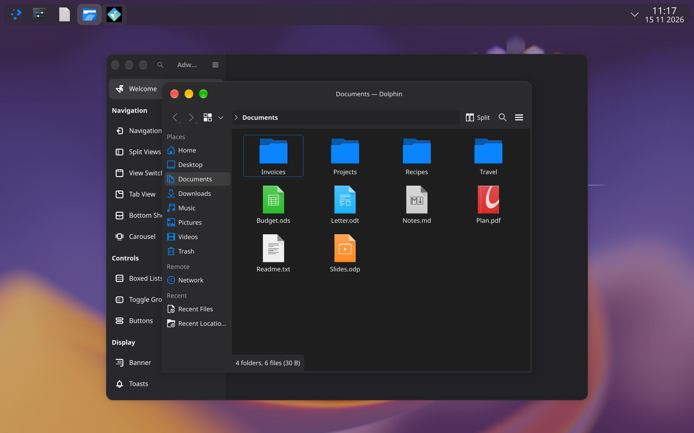
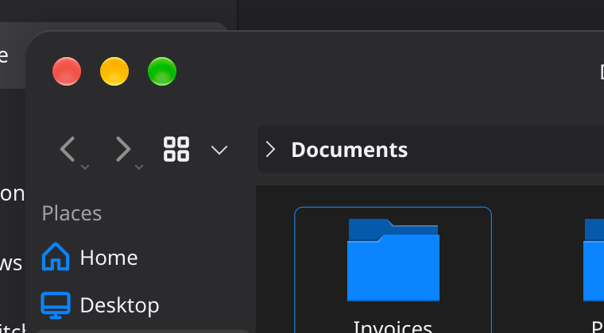
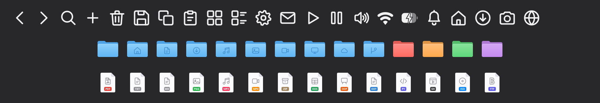
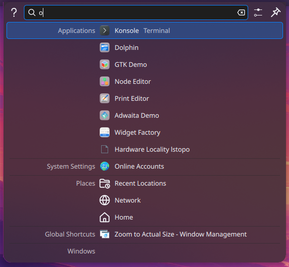
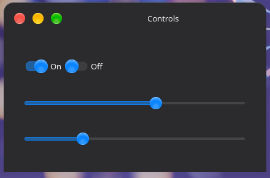

# Golden Delicious for KDE Plasma

A lean Plasma 6 theme with the feel of macOS: traffic-light window buttons,
rounded corners with a soft shadow, a floating translucent top panel, rounded
popups, a dark color scheme with blur, and its own icons.



<sub>Wallpaper from the Tokyo Night theme of [Omarchy](https://omarchy.org).</sub>

## What's in it

**Windows.** Traffic lights on the left with the light and sheen of the Mac
ones, rounded corners, a soft shadow. libadwaita and GTK apps get the same
buttons on the same side.



**Icons.** About 2000 line icons of our own for actions, places, devices and
status, under Breeze's names, so every KDE app picks them up. In the panel the
wifi and the battery look like the Mac menu bar. From 32 px up folders turn
into blue Mac folders with the place's symbol embossed (and the tag colours for
`folder-red` and friends), and files into white pages with a coloured label
for their type.



**App icons on tiles.** App icons keep their own design but sit on a light
macOS squircle tile. The originals stay untouched (optional, see Install).



**Plasma.** A floating top panel, popups as round as the windows, and switches
and sliders with a knob in the accent colour, lit like the traffic lights.



## Install

Run inside a Plasma session:

```sh
./install.sh            # keep your panels, change only the look
./install.sh --layout   # also replace your panels with the theme's top panel
```

Both scripts first list what they will change and ask before they start;
`-y` or `--yes` skips that (and sets up the tiles, see below). Use them at your
own risk. `--layout` drops your current panel setup and pinned launchers. Log
out and back in afterwards so every app, the panel and the icon caches pick the
theme up.

On the first install the script asks whether to set up the app icon tiles: a
small user service (`golden-delicious-tiles`) draws them into
`~/.local/share/icons/golden-delicious-apps` and runs again whenever apps or
Flatpaks come or go. Once set up, later installs update it without asking.
`--tiles` or `--no-tiles` answer the question up front.

GTK apps follow too: Breeze GTK takes the colors and window buttons from KDE,
and `gtk/golden-delicious.css` adds the traffic lights for libadwaita apps and
hides separators. Flatpak apps get read access to that config.

## Backups

Each install first saves the config it touches (kdeglobals, kwinrc, plasma
rc files, kdedefaults, gtk-3.0, gtk-4.0) to
`~/.local/state/golden-delicious/backups/`. The newest 5 are kept; set
`GG_KEEP_BACKUPS` to change that.

```sh
./restore.sh --list   # list backups, newest last
./restore.sh          # restore the newest one
./restore.sh <dir>    # restore that one
```

A restore puts back whole files and backs up the current state first, so it
can be undone the same way. To undo the theme, uninstall.sh is the better fit
(see Revert): from the second install on, the backups already hold the theme.

## Revert

```sh
./uninstall.sh            # put back your settings from before the first install
./uninstall.sh --layout   # also your panels (if you installed with --layout)
```

The first install records every setting it changes as it was before, in
`~/.local/state/golden-delicious/original`; later installs (updates) keep that
record. uninstall.sh puts each setting back from it, key by key, so changes you
made elsewhere in the meantime stay: global theme, colors, icons, Plasma style,
window decoration and buttons, blur, GTK theme and buttons, GNOME's button
layout, the Flatpak access to the GTK config and the Breeze GTK theme for
Flatpak apps (removed only if install.sh added it). With `--layout` it puts
back the panels from before the first install with `--layout`. It also removes
the theme's files, the tile service and our GTK CSS. Your backups stay.

Installed with an older install.sh, there is no record: uninstall.sh then
switches to Breeze Dark with Breeze's window buttons instead, and restore.sh
can bring back a backup.

## Develop

The SVGs under `src/aurorae` and `src/plasma/desktoptheme` are generated:
edit `dev/gen-aurorae.py` or `dev/gen-plasma.py` and rerun them.
`dev/gen-icons.py` builds the icon theme in `src/icons/golden-delicious` from our
drawings in `dev/icons/src` (style in `dev/icons/STYLE.md`), under Breeze's
names and aliases; a name not drawn yet gets Breeze Dark's icon with every line
0.4 px wider. From 32 px up, folders are colour folders like macOS with
the place's symbol embossed (`dev/icons/folders.py`); file types are white
pages with the extension on a coloured label (`dev/icons/filetypes.py`). It
runs in the harness image, which has the pinned Breeze icons.

To see the result without touching your desktop, render a screenshot in a
pinned headless Plasma 6.8 (needs Docker and `/dev/dri`):

```sh
dev/shot-docker.sh tmp/shots/out.png --install dolphin konsole
```
